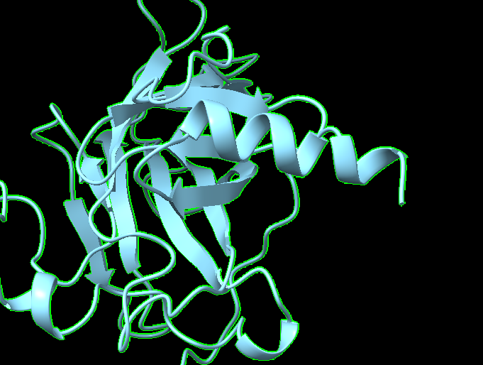
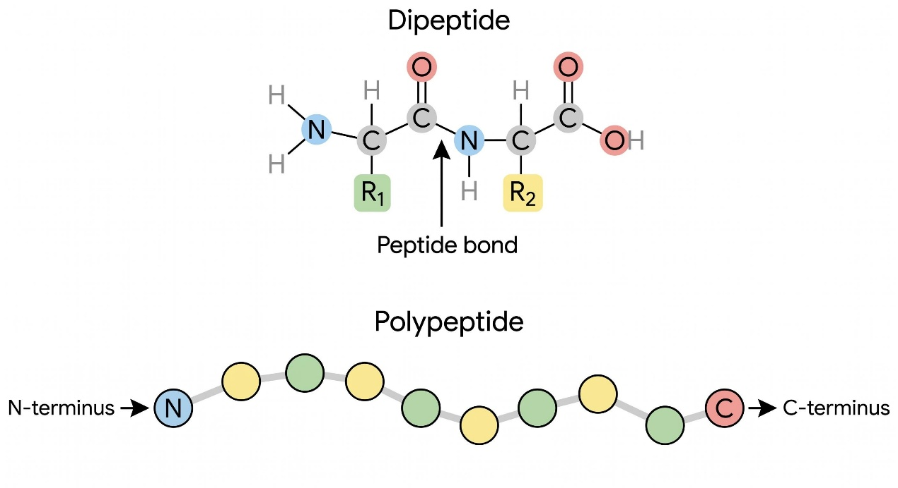
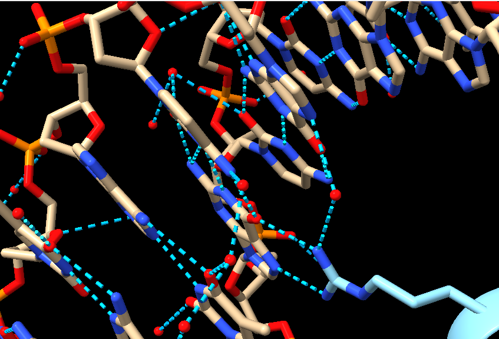
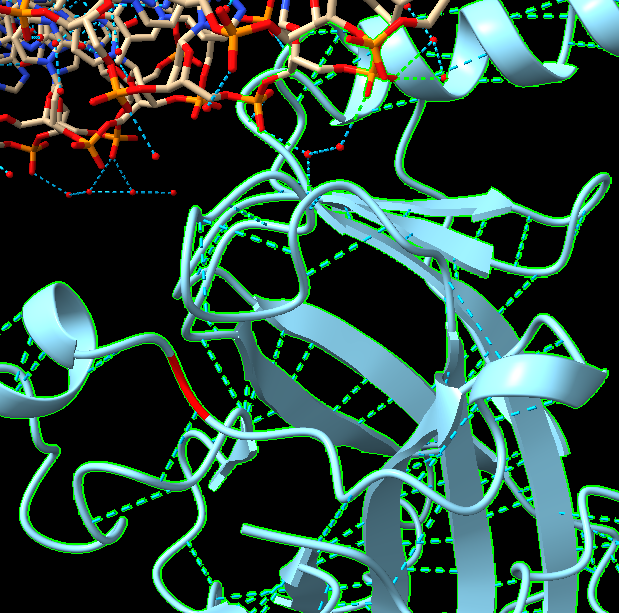

Scientist’s Mission(0153B001, 孫于涵)

Who Stole TP53’s Superpower? Searching for the Key to Unlock Cancer

Using AI to Uncover the Secrets of TP53–DNA Interactions

1. 【The LEGO Assembly Line】

What type of bond links amino acids together to form a protein? Which amino acids form hydrogen bonds with each other?

Answer:

Amino acids are linked together by peptide bonds to form a protein's primary sequence. A peptide bond is a strong covalent bond formed when the carboxyl group of one amino acid reacts with the amino group of another, releasing a molecule of water in a dehydration reaction.

While rigid peptide bonds act as the backbone, hydrogen bonds are responsible for folding the polypeptide chain into its functional 3D shape.

Backbone Interactions: The oxygen and nitrogen atoms within the backbone of all amino acids form hydrogen bonds with each other to create secondary structures like alpha-helices and beta-pleated sheets.

Side-Chain Interactions: Amino acids with polar or electrically charged side chains form intra-protein hydrogen bonds with each other to stabilize the overall 3D tertiary structure. The amino acids capable of side-chain hydrogen bonding include Serine, Threonine, Tyrosine, Asparagine, Glutamine, Arginine, Lysine, Histidine, Aspartic acid, and Glutamic aci

In the p53 tumor suppressor protein (encoded by the TP53 gene), the intra-protein hydrogen bond network is highly specific and critical. Because p53 must perfectly align its DNA-binding domain (DBD) to recognize and latch onto target DNA sequences, its structural stability relies heavily on precise internal amino acid interactions.

Structural studies of wild-type p53 have identified several specific amino acid pairs that form crucial internal hydrogen bonds (and ionic salt bridges) to lock the protein into its functional conformation:

Glutamate 171 (E171) & Arginine 249 (R249): These two residues form a vital native salt bridge and hydrogen bond network that anchors and stabilizes the core of the DNA-binding domain.

Threonine 253 (T253) & Tyrosine 236 (Y236): T253 is buried deep within the hydrophobic core of the p53 protein and engages in hydrogen bonding with Y236 to hold the internal structural architecture together.

Tryptophan 91 (W91) & Arginine 174 (R174): These residues form stabilizing contacts that help maintain the extended domain of the protein against cellular stress.

When single-amino-acid mutations occur in the TP53 gene—such as the notorious cancer-associated mutations R175H (Arginine to Histidine at position 175) or G245S (Glycine to Serine at position 245)—they sever these specific hydrogen bonds. This causes the DNA-binding domain to physically unfold, aggregate, and lose its ability to bind to DNA, 

2. 【The Double-Track Highway of Life’s Blueprint】

How do nucleotides assemble to form double-stranded DNA? What are the basic structural components of DNA? Is DNA right-handed or left-handed? List the names of the four DNA bases. Which bases form hydrogen bonds with each other?

Answer:

nucleotides pair up to form a double helix. Every single nucleotide consists of three fundamental components: A Phosphate Group, A 5-Carbon Suga, A Nitrogenous Base

Nucleotides assemble into double-stranded DNA through two different types of bonds:

Vertical Assembly (Phosphodiester Bonds): nucleotide forms a strong covalent bond with the deoxyribose sugar of the next nucleotide. 

Horizontal Assembly (Hydrogen Bonds): Two separate single strands connect to each other in the middle via weaker hydrogen bonds between their nitrogenous bases. 

The standard form of DNA found in living cells (known as B-DNA) is a right-handed double helix

here are four nitrogenous bases in DNA, divided into two categories:

Purines (double-ring structure): Adenine (A) and Guanine (G)

Pyrimidines (single-ring structure): Thymine (T) and Cytosine (C)

Adenine (A) pairs with Thymine (T): Forming 2 hydrogen bonds.

Guanine (G) pairs with Cytosine (C): Forming 3 hydrogen bonds.

3. 【Searching for My One-and-Only Soulmate in the Universe: A 20-Base-Pair Love Code Hidden Among 3 Billion DNA Base Pairs】

The source of molecular stability and specificity: hydrogen bonding — How do TP53 and DNA recognize each other?

Using the structure 3KMD, identify one pair of an amino acid and a DNA base that interact with each other.

Answer:

TP53 (the p53 protein) and DNA recognize each other through a highly specific combination of direct chemical bonding and structural matching, primarily governed by hydrogen bonds. 

4. 【Return to the Crime Scene】

Why can a mutation (change) in just one amino acid of a protein sometimes lead to a serious human disease? Give one specific example of such a disease.

Answer:

5. 【Return to the Crime Scene: Searching for Clues】

Using the TP53–DNA structure (3KMD), identify one TP53 amino acid mutation that can lead to uncontrolled cell division and contribute to the development of cancer.

Then examine this amino acid in ChimeraX. Based on its three-dimensional position, determine whether the mutated amino acid is located directly at the protein–DNA interface or somewhere else in the protein.

Answer:

Paste a screenshot of your ChimeraX visualization here.

b. Save your ChimeraX session file as StudentID.cxs.

